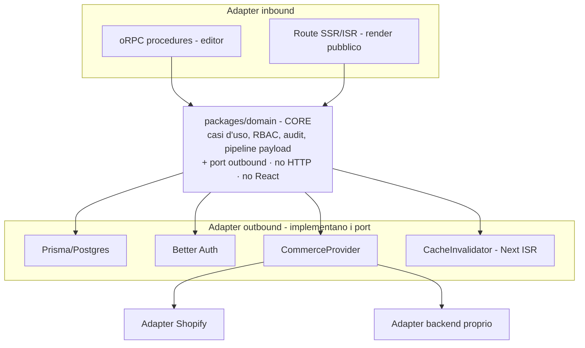
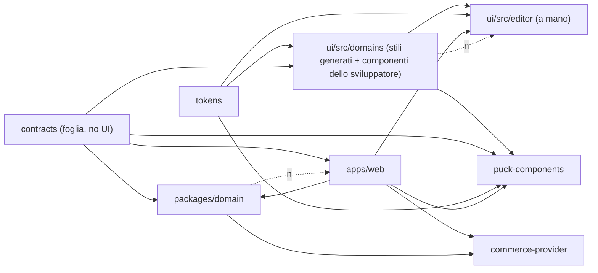

# Architecture Spine — page-builder

> Contratto di consistenza per la riscrittura. Fissa gli invarianti che tengono allineate unità costruite in modo indipendente; lo stack e la struttura sono seed (veri al cold-start, poi di proprietà del codice). Il razionale delle scelte vive nel `.memlog.md` di questo run.

## Design Paradigm

**Esagonale (Ports & Adapters) dentro un monolite Next.js fullstack.**

Un **core di dominio** framework-agnostic (niente HTTP, niente React) in `packages/domain` contiene tutti i casi d'uso — pages, versions, publish/rollback/archive/restore, RBAC, audit, pipeline payload (validazione/classificazione/sanitizzazione) — e i **port** verso l'esterno. Tutto il resto sono **adapter** attorno al core:

- **adapter inbound**: procedure oRPC (editor), route SSR/ISR (render pubblico).
- **adapter outbound** (implementano i port del core): persistenza (Prisma/Postgres), identità (Better Auth), sorgenti commerce (CommerceProvider), invalidazione cache (CacheInvalidator).



Il core è deliberatamente **estraibile**: se domani serve un'API standalone, le si mette sopra un adapter HTTP senza toccare il dominio.

## Invariants & Rules

Diagramma delle dipendenze consentite (chi può dipendere da chi). È **una regola**, non solo una vista.



### AD-1 — Core di dominio esagonale, unico punto di accesso al dominio

- **Binds:** CAP-6…CAP-14; ogni mutazione **e** lettura non-pubblica del dominio.
- **Prevents:** logica di dominio sparsa nel layer web, non riusabile e non enforced in un solo punto (la regressione legacy dei CRUD auto-generati scoperti).
- **Rule:** ogni **mutazione** di `Page`/`PageVersion`/`PageAssignment` e ogni **lettura non-pubblica** (dettaglio pagina non pubblicata, anteprima draft, storico versioni, audit) passa da un caso d'uso di `packages/domain`. Il core non importa React né tipi HTTP. **Nessun CRUD auto-generato** e nessun accesso Prisma diretto dagli adapter inbound espone entità di dominio scavalcando i casi d'uso. Unica eccezione (AD-4).

### AD-2 — Topologia monolite fullstack con core estraibile

- **Binds:** tutta l'app.
- **Prevents:** un contratto di rete da progettare/versionare e un hop extra per l'SSR, superflui per un greenfield a singolo sviluppatore.
- **Rule:** una sola app deployabile (`apps/web`) ospita editor + render + adapter. Il **core vive in `packages/domain`** (non dentro `apps/web`), senza dipendenze da React/HTTP/Next, così un'estrazione futura in servizio non tocca il dominio.

### AD-3 — Il frontend consuma il design system, non uno stack UI parallelo [ADOPTED]

- **Binds:** CAP-3, CAP-4, CAP-5, CAP-6; `apps/web`.
- **Prevents:** due stack UI paralleli e divergenti (il drift legacy: app su react-bootstrap invece delle composizioni del design system).
- **Rule:** `apps/web` costruisce la UI **solo** su `@penpot-ds/ui` (+ token). Vietato introdurre una libreria UI **stilistica** concorrente. Le primitive **headless** (Base UI) non sono una libreria concorrente: non portano stile, sono la dipendenza di *comportamento* fissata in `pds-setup` (`headless=base-ui`) e usata dal componente dello sviluppatore (AD-11), e sono importabili **solo** da `@penpot-ds/ui/src/domains/**` — mai da `apps/web`, mai da `editor/**`. Layering `contracts ← { ui/domains, puck-components, domain, render }; tokens ← ui{ domains ← editor } ← puck-components` — `contracts` è una foglia come `tokens`; `ui/domains` implementa i contratti, non li possiede (AD-5). **Regola di confine assoluta:** i componenti in `domains/` non conoscono il dominio page-builder e non importano mai da `editor/`. Persa la barriera di package con la fusione, il confine è tenuto da una **regola di lint bloccante in CI** e dai due export separati del package.

### AD-4 — RBAC deny-by-default a copertura totale nel core; auth ≠ authz [ADOPTED]

- **Binds:** CAP-11, CAP-12, CAP-13; ogni via di lettura/scrittura del dominio.
- **Prevents:** authz sparsa tra provider auth e app; ruolo grossolano scambiato per permesso su risorsa; endpoint (write **o read**) che toccano dominio senza check.
- **Rule:** Better Auth fornisce **identità + ruolo grossolano** (`Principal { userId, role }`, `role ∈ {ADMIN, EDITOR, CLIENTE}`) nel context oRPC. L'**autorizzazione fine** (es. "questo Cliente è assegnato a questa pagina?" via `PageAssignment`; "questo campo è content o structure?") è **dato di dominio** decisa dal core, deny-by-default. Ogni adapter inbound passa il `Principal` al core; nessun adapter decide da sé. **Unica lettura anonima ammessa:** la versione PUBLISHED `by-slug` su una **proiezione pubblicata** (nessun campo interno/draft). La UI può nascondere, ma non è mai l'unico controllo.

### AD-5 — Contratti dei componenti: una sola fonte di verità in `packages/contracts` [rivisto 2026-09-12]

- **Binds:** CAP-2, CAP-4, CAP-6, CAP-13.
- **Prevents:** duplicazione/drift della classificazione structure/content (il dolore #1 del legacy: `field-classifier.json` duplicato a mano in Java); payload non validato/non sanitizzato; **contratto disperso negli adapter (libreria, editor, render) che lega le pagine salvate a una libreria specifica**.
- **Rule:** `packages/contracts` (`@app/contracts`) contiene **una sola volta**: gli schemi Zod delle props di ogni componente/blocco, gli assi **`option`** (l'unico tipo di asse del contratto; `state` è un nome d'asse riservato in Penpot, mai una prop, AD-11), i field, gli slot, il classifier structure/content e le **definizioni di sezione** (contratto con almeno uno slot: field + slot con `allow` e `max`; l'albero sta in Penpot e nel componente, AD-11). **Zero dipendenze** da React, Puck, Tailwind e da Penpot. È la porta; gli adapter sono `ui/domains` (libreria), `puck-components` (editor), render pubblico, `packages/domain` (validazione).
  Alla scrittura/pubblicazione il core: (1) valida il payload contro i contratti, inclusi `allow`/`max` degli slot (Puck 0.22 non ha `max` nativo: in editor si impone con `resolvePermissions`, **nel core è autoritativo**); (2) deriva structure/content dal classifier; (3) **sanitizza i campi content** (XSS) prima di persistere. Default per campo/blocco ignoto: `content` (fail-safe).
  **Sezioni rigide per default**: struttura bloccata, contenuto modificabile, aperte solo negli slot dichiarati — decisi da sviluppatore/admin, non dal designer. **Blocchi di layout a soli token**: Box (background, padding, radius, border), Flex (direction, align, justify, gap, wrap), Grid/Columns — tutti assi `option` a valori token, nessun colore o misura libera.

### AD-6 — Forma del payload, proprietà di id/versioni

- **Binds:** CAP-6, CAP-8, CAP-9, CAP-14.
- **Prevents:** riscrittura della struttura Puck; perdita del diff a livello di blocco; race sull'allocazione del numero di versione.
- **Rule:** il payload è la forma Puck `{content, root, zones}` con `schemaVersion`, persistito 1:1 in colonna `Json` (jsonb). **Proprietà:** i **block-id** sono coniati dal client e **immutabili** — il core non li riscrive mai; **`schemaVersion`** è di proprietà di `packages/contracts` — un cambio di contratto (nuovo asse o valore) è un bump esplicito; il **`versionNumber`** è allocato dal **core in transazione**, con vincolo `UNIQUE(page_id, version_number)`.

### AD-7 — Coerenza di pubblicazione enforced dal DB e in transazione

- **Binds:** CAP-8, CAP-9, CAP-10, CAP-11.
- **Prevents:** due versioni PUBLISHED per pagina; pagina archiviata con una versione ancora pubblicata servita da SSG.
- **Rule:** l'invariante **≤1 PUBLISHED per pagina** è garantito da un **indice univoco parziale Postgres** (`UNIQUE (page_id) WHERE status='PUBLISHED'`), applicato via **migration SQL esplicita** — scelto per una garanzia autoritativa a livello DB indipendente dallo stato preview del DSL ORM, non come workaround di un bug. Publish/rollback/archive avvengono in **un'unica transazione** che accoppia `Page.status` e `PageVersion.status`: promuovere una versione demota la precedente; **archiviare una pagina demota la sua versione PUBLISHED**. Il DB è la rete di sicurezza autoritativa.

### AD-8 — Audit applicativo nel core, sui metadati, un solo writer

- **Binds:** CAP-14.
- **Prevents:** audit parziale o aggirabile; duplicazione dell'intero blob di contenuto; righe di audit di forma incompatibile.
- **Rule:** ogni caso d'uso di mutazione scrive tramite un **unico `AuditWriter`** una riga `AuditLog` di **forma canonica** (`actor`, `action`, `entityType`, `entityId`, `timestamp`, `metadataDiff` — **non** il payload intero). Copertura totale perché ogni mutazione passa dal core (AD-1). Consultabile solo da ADMIN. Lo storico dei **contenuti** resta modellato dalle `PageVersion`, non dall'audit.

### AD-9 — Render pubblico: SSG + ISR, invalidazione via port

- **Binds:** CAP-8, CAP-11.
- **Prevents:** HTML pubblico stantio dopo un publish; leak di bozze nella cache pubblica; accoppiamento del core a Next.
- **Rule:** le pagine pubbliche `by-slug` sono servite come **SSG + ISR** dalla proiezione pubblicata (AD-4). Il core resta **puro**: espone un port **`CacheInvalidator`** che un adapter implementa con `revalidateTag(slug)`/`revalidatePath`, invocato **post-commit** su publish/rollback/archive. Draft e published hanno **domini di cache disgiunti** (tag/funzioni di fetch distinti, mai condivisi); l'anteprima draft (`by-slug?version=draft`) è **render dinamico non cachato** e protetto da auth (AD-4).

### AD-10 — Integrazione commerce dietro il port CommerceProvider

- **Binds:** CAP-11; blocchi commerce; render storefront.
- **Prevents:** lock-in su una sorgente commerce; riscrittura dei blocchi al cambio/affiancamento di sorgente; chiamate commerce dirette sparse nei blocchi; DTO commerce incompatibili tra blocchi.
- **Rule:** i blocchi commerce (ProductCard/ProductGrid/AddToCart/…) e il render **non** parlano mai direttamente a Shopify o a un backend specifico, ma al **port `CommerceProvider`** con contratto canonico (metodi es. `getProduct`/`listProducts`/`getCollection`; DTO `ProductRef`, `Price { amount, currency }`, …). Adapter: Shopify (Storefront API GraphQL) e backend proprio. La risoluzione dati avviene **server-side a render-time** (`resolveData`/external fields di Puck).

### AD-11 — Un contratto, Penpot letto dal vivo, stili generati e componente dello sviluppatore [ADOPTED, v3 2026-10-17 — supera AD-11 v2 (2026-09-17) e la spine 2026-10-03]

- **Binds:** CAP-1, CAP-2, CAP-3, CAP-4.
- **Prevents:** valori di design inventati a mano; drift design ↔ codice; vocabolario delle props, e quindi le pagine salvate, legato alla libreria o a Penpot; metadati per componente scritti a mano che divergono; letture salvate o fixture che invecchiano; codice dello sviluppatore riscritto dal generatore; fedeltà persa in silenzio; scritture senza consenso; componenti non accessibili perché il comportamento non si disegna.
- **Rule:**
  **Un solo file per componente: il contratto dell'editor.** `packages/contracts/src/components/<nome>.ts`, o `sections/<nome>.ts` per una sezione; assi `option`, field, slot; versionato da `SCHEMA_VERSION` + fingerprint (AD-5, AD-6). Lo propone la skill (dal contratto o dal design), lo approva lo sviluppatore. Nessun altro metadato per componente nel repo: niente contratto di estrazione, istantanea, binding, ricetta salvata.
  **Da dove viene ogni informazione.** Parti, albero, istanze annidate e variante scelta, celle, token, layout e geometria: **Penpot, letto dal vivo** a ogni chiamata. Elemento HTML, field → parte, icone, comportamento, a11y: **il componente dello sviluppatore**. Il legame Penpot ↔ codice è la chiave di parte, che in codice è `data-slot`.
  **Metadati in Penpot.** Shared plugin data `pagebuilder`: `contract = nome@versione` sul container; `part=<chiave>` sul layer (sopravvive al rename, passa alle istanze, Ctrl+D la copia); `when=<field>`, `slot=<id>` e le risposte alle domande. Li scrive **solo `pds-code`**, alla generazione, via MCP Penpot, con conferma. Mai stile, geometria, layer o token: il disegno è del designer, che non scrive metadati. Il nome del layer è libero e serve solo a proporre la chiave.
  **Stili generati, componente dello sviluppatore.** Il generatore scrive `<Comp>.styles.ts` (una `cva` per chiave di parte, tutti gli assi, varianti delle istanze annidate) e `<Comp>.stories.tsx` (una per cella, figli di default del contratto per le sezioni), entrambi `@generated` con versione del generatore e hash. `<Comp>.tsx` lo crea lo scaffold una volta, poi è dello sviluppatore e il generatore non lo tocca più. Il lato codice lo controlla `tsc` (chiavi esportate da `styles.ts`); la verifica controlla solo il lato Penpot. Una parte tolta di proposito dallo sviluppatore è un avviso (export inutilizzato). Un cambio di struttura rigenera solo `styles.ts`; per ogni parte aggiunta, tolta o diventata lista la skill suggerisce la modifica del TSX con un esempio sul file attuale e la applica solo su richiesta.
  **Esiti: avviso, blocco, domanda.** L'aspetto produce solo avvisi. Un caso ambiguo è una **domanda** con le opzioni: la skill chiede, la risposta si scrive in Penpot sul layer e non si richiede più. Chiavi doppie (lista `repeat` o parte nuova), parti senza chiave e domande aperte fermano `generate_component`, che non scrive finché restano.
  **Assi e stati.** Nel contratto solo assi `option`. Un field `structure` è un asse se Penpot ha una variante con lo stesso nome, altrimenti è un rendering condizionale con `when=<field>` su una parte; né l'uno né l'altro → domanda. Focus e disabled hanno un default nel CSS globale (anello `ring`, opacità 50%); una cella disegnata vince; il focus non si toglie. Hover e active esistono solo se disegnati, sull'asse riservato `state` (una cella per variante su una taglia, applicata col prefisso a tutte le taglie), mai una prop; le celle mancanti non sono un errore.
  **Componente e sezione.** Componente: tutti i pezzi li sceglie il designer. Sezione: almeno uno slot. Le parti proprie seguono le stesse regole; una sezione con parti proprie ha container, `styles.ts` e scaffold, una di sola disposizione no. Slot = layer i cui figli sono tutti istanze dei componenti ammessi; se ambiguo → domanda, `slot=<id>`. Un'istanza in Penpot diventa `<Comp />` nel codice: variante scelta dal designer e validata, override di stile vietati, testo solo d'esempio.
  **Geometria.** Ogni voce nel registro ha una traduzione; le regole di contesto sono funzioni del nucleo. La misura fissa della radice si ignora se è uguale in tutte le celle, entra nella `cva` se cambia tra le celle (a′). Un valore fuori scala diventa un valore arbitrario (`w-[37px]`) con un avviso ripetuto e il valore in scala più vicino; mai una classe persa in silenzio. Ritaglio: `overflow-hidden` se un figlio esce o se il genitore ha un raggio e un figlio tocca un bordo; ignorato se niente esce e non c'è contenuto variabile; domanda se niente esce ma c'è contenuto variabile. `left+right` e `top+bottom` si traducono; un vincolo non traducibile (`scale`) dà un avviso e nessuna classe; "fill" dentro hug è una domanda.
  **Comportamento e a11y.** Primitivo Base UI se esiste (lo scaffold lo usa); altrimenti ricetta shadcn `base` letta dal vivo + pattern APG, mai salvata. La skill propone prima un elenco di comportamenti, poi un diff piccolo per comportamento con conferma e un test per ognuno (file dello sviluppatore). Le dipendenze nuove le sceglie lo sviluppatore, con l'alternativa senza dipendenze. axe è bloccante su ogni story `@generated`; la tastiera è coperta dai test di comportamento; "testo + colore" è una voce fissa del giudizio in Storybook.
  **Tema e font.** Seme `theme.css` (Tailwind v4 + ruoli shadcn) → token Penpot (`tokens_from_css`); poi la fonte è Penpot e `extract_theme` scrive `theme.css` e `themes/<gruppo>-<nome>.css` per le varianti dichiarate come `[data-<gruppo>="<nome>"]`, e `fonts.css` dalle famiglie del tema. Il tema Penpot vince nel CSS compilato. Font via `fontsource`, caricati dallo stesso file in Next e in Storybook; niente `next/font`.
  **Script: nucleo puro, un adattatore, un guscio.** TypeScript in `packages/scripts`; il nucleo legge `@app/contracts` ed è fatto di funzioni dati → dati (niente disco, rete, console, exit code). `readComponent` è l'unico punto che parla con Penpot (`execute_code`). Il guscio è il **server MCP `pds`**, senza CLI di prodotto: senza stato, rilegge Penpot a ogni chiamata, non scrive mai su Penpot, non decide. Strumenti: `tokens_from_css`, `describe_component`, `verify_component`, `build_order`, `generate_component` (restituisce `Change[]` e scrive lui i file `@generated`), `extract_theme`. Tipi interni (`Lettura`, `Finding`, `Change`) zod con nome e senza versione.
  **Due skill.** `pds-design` (verso Penpot: tema, varianti di tema, contratto nuovo, disegno via kit, contratto dal design, modifica di struttura) e `pds-code` (verso il codice: tema, verifica, generazione, aggiornamento, gate), wrapper delle skill di penpot-ai-kit dove ha senso; `pds-setup` resta. Nessuno script tra i contratti e Penpot: i componenti li disegna il designer col kit.
  **Ordine.** Niente livelli: `build_order` genera un componente solo se esistono già i componenti che contiene.
  **Configurazione di progetto** in `pds-setup`: `framework=react`, `headless=base-ui`, `styling=tailwind-v4`, `fonts=fontsource`, un valore implementato per chiave; un valore non supportato è un rifiuto esplicito.
  **CI senza Penpot, quattro livelli:** nucleo con dati minimi scritti a mano; server in memoria con un adattatore Penpot finto; hash e versione dei file `@generated` (hash che non torna = blocco, versione vecchia con hash giusto = avviso); ogni classe del registro, espansa sui token del tema generato, produce CSS con la Tailwind installata, più il test di `tokens_from_css` sul seme. Nessuna lettura di Penpot salvata nel repo.
  **Collaudo degli aggiornamenti di Penpot.** Un componente campione che usa tutte le proprietà del registro, salvato come `.penpot` nel repo. A ogni aggiornamento: istanza nuova, import, collaudo lanciato a mano; ogni proprietà del registro compare nella lettura. Il Penpot vero si aggiorna solo se il collaudo passa.
  **Fuori da Penpot.** Un componente senza container è scritto a mano: contratto sì, niente di generato, solo il gate. Un disegno fatto altrove si riporta in Penpot.
  I file `@generated` non si editano a mano; i file senza marker sono sempre preservati. Dettaglio → companion `penpot-pipeline.md`.

### AD-12 — Snapshot di contenuto immutabili

- **Binds:** CAP-7, CAP-8, CAP-9, CAP-12, CAP-13.
- **Prevents:** mutazione in-place della versione pubblicata; perdita di storico; un Cliente che altera struttura.
- **Rule:** ogni salvataggio di contenuto (autosave incluso) **crea sempre una nuova `PageVersion` DRAFT**; mai mutazione in-place di una versione esistente/pubblicata. Le modifiche **content-only del Cliente** creano una nuova DRAFT in cui solo i campi `content` (classifier, AD-5) sono modificabili; i campi `structure` sono bloccati e rifiutati dal core.

### AD-13 — Errori di dominio tipizzati e semantica 404/403

- **Binds:** tutte le procedure oRPC; AD-4.
- **Prevents:** shape errori divergenti tra unità; leak dell'esistenza di risorse a utenti non autorizzati.
- **Rule:** gli errori di dominio sono un **set tipizzato** mappato a un insieme fisso di errori oRPC (shape unico, non stringhe libere). Coerente col deny-by-default: su risorsa **non-pubblica** per cui il `Principal` non è autorizzato si risponde **404** (non si rivela l'esistenza), non 403; 403 è riservato ad azioni note-ma-vietate su risorse la cui esistenza è già lecita conoscere.

## Consistency Conventions

| Concern | Convention |
| --- | --- |
| Naming entità | `Page` (slug pubblico univoco), `PageVersion`, `PageAssignment` (Cliente↔pagina), `AuditLog`; `PageStatus` DRAFT/PUBLISHED/ARCHIVED, `PageVersionStatus` DRAFT/PUBLISHED |
| Confini package | `@app/contracts` = contratti dei componenti, classifier, definizioni di sezione (no React/Puck/UI); `@penpot-ds/*` = design system (`tokens` + `ui` + `puck-components`; nessun package `primitives`); `packages/domain` = core (no React/HTTP); `packages/commerce-provider` = port + adapter |
| Contratti condivisi core-attraversanti | tipi canonici e proprietari unici: `Principal` (context oRPC), `AuditLog` (via `AuditWriter`), `CommerceProvider` DTO, `CacheInvalidator` port, errori di dominio tipizzati (AD-13) |
| Transport / errori | oRPC editor→dominio; OpenAPI derivato; errori di dominio tipizzati → set oRPC fisso (AD-13) |
| Dati & formati | id/date default Prisma/Postgres; payload `Json` (jsonb) forma Puck `{content,root,zones}`; block-id client-owned immutabili; `versionNumber` core-owned `UNIQUE(page_id, version_number)` |
| Auth | Better Auth (sessione cookie editor); `Principal + role` nel context oRPC; authz fine sempre nel core, deny-by-default (read **e** write) |
| Mutazione di stato | solo via casi d'uso del core; publish/rollback/archive in transazione che accoppia `Page.status`↔`PageVersion.status`; ogni save = nuova DRAFT (AD-12); ≤1 pubblicata come backstop DB |
| Cache | domini disgiunti draft/published; invalidazione post-commit via port `CacheInvalidator` (AD-9) |
| Validazione/sanitizzazione | schemi Zod dei **contratti** (`@app/contracts`) condivisi FE/BE; sanitizzazione XSS dei campi `content` lato server prima di persist/publish |
| Accessibilità | baseline WCAG 2.1 AA obbligatoria per primitive/composizioni (companion `a11y-baseline.md`); focus e disabled con default globale, axe bloccante sulle story generate (AD-11) |

## Stack

| Name | Version |
| --- | --- |
| TypeScript | ~6.0 |
| Next.js (App Router) | 16.x |
| React | 19 |
| PostgreSQL | 18 |
| Prisma | 7.9+ |
| Better Auth | corrente (attivo lug 2026) |
| oRPC | corrente |
| @puckeditor/core | 0.22.x |
| Tailwind CSS | 4 |
| Node.js | LTS |
| pnpm | 10 |
| Turborepo | 2 |
| create-better-t-stack (scaffold) | 3.37.0 |
| Penpot (self-hosted) | 2.18.3 |
| penpot-ai-kit | 0.5.1 |
| @base-ui/react | ^1.8.0 |
| @fontsource/* | corrente all'installazione (Story 2.26) |

> Versioni verificate contro il registry npm al 2026-07-25 (`@measured/puck` è deprecato → `@puckeditor/core`; Next 16.x corrente; Prisma 7.9). Da riconfermare al momento dello scaffold; il codice diventa proprietario di questi pin una volta creato.

## Structural Seed

Workspace **greenfield** (oggi contiene solo `docs/` come riferimento legacy). Monorepo pnpm + Turborepo. I `packages/*` del design system sono **(ri)costruiti** in questa riscrittura guidati da SPEC+companion — token, tema, font e stili dei componenti `domains/` **generati** via pipeline Penpot v3 (AD-11), componenti React dello sviluppatore; lo spine ne ratifica **ruoli e layering**, non un codice preesistente.

```text
page-builder/
  apps/
    web/                     # Next.js App Router — editor + render pubblico (adapter)
      app/
        (public)/[slug]/     # render storefront SSG+ISR, proiezione pubblicata (AD-4,9,10)
        (app)/               # editor autenticato — isole 'use client' (Puck)
      src/
        orpc/                # adapter inbound: procedure oRPC (Principal→core, AD-4)
        adapters/            # impl. dei port: Prisma, Better Auth, CacheInvalidator
  packages/
    domain/                  # CORE esagonale: casi d'uso, RBAC, audit, pipeline payload, PORT (AD-1,2,4,5,8)
    commerce-provider/       # port CommerceProvider + adapter Shopify/custom (AD-10)
    contracts/               # @app/contracts — schemi props, tipi di asse, classifier, definizioni di sezione; zero dipendenze UI (AD-5, AD-6, AD-11)
    tokens/                  # @penpot-ds/tokens — GENERATO da Penpot: theme.css, themes/*.css, fonts.css (AD-11)
    ui/                      # @penpot-ds/ui — libreria componenti unica (AD-3, AD-11)
      src/domains/           #   data-display, inputs, feedback, layout, navigation, overlays, commerce:
                             #   <Comp>.styles.ts e .stories.tsx @generated; <Comp>.tsx dello
                             #   sviluppatore (scaffold una tantum), Base UI headless + token
                             #   export `.`  → unico consumo per puck-components
      src/editor/            #   A MANO: composizioni di prodotto (TopBar, PageList,
                             #   LifecycleBadge, SaveStateIndicator, EmptyState, VersionList)
                             #   export `./editor` → unico consumo per apps/web (app)
    puck-components/         # @penpot-ds/puck-components — adapter Puck dei contratti: config, permissions, resolvePermissions (AD-5)
    scripts/                 # pipeline Penpot→codice v3 (AD-11)
      src/core/              #   nucleo puro: tipi zod (Lettura, Finding, Change), registro, geometria,
                             #   verifica, generatore, ordine, tema — dati → dati
      src/penpot/            #   readComponent: unico punto che parla con Penpot (execute_code)
      src/server/            #   server MCP pds: sei strumenti, senza stato, scrive i file @generated
      collaudo/              #   campione .penpot con tutte le proprietà del registro
    storybook/               # docs/playground
```

**Envelope operativo.** Ambienti dev/staging/prod. Deploy come **container Docker self-host** (Next `output: standalone`), Postgres containerizzato/gestito, portabile in un futuro ecosistema microservizi (no lock-in di piattaforma). Le **migration** (incluso l'indice parziale SQL di AD-7) girano via `prisma migrate deploy` in fase di **release, prima dell'avvio app**, con gate in CI. Secret via env/secret manager. Logging/monitoring: strategia nominata, dettaglio in Deferred. Dev: Docker Postgres.

## Capability → Architecture Map

| Capability | Lives in | Governed by |
| --- | --- | --- |
| CAP-1/CAP-2 pipeline Penpot→token/tema/stili (v3) | `packages/scripts` (nucleo, adattatore, server MCP `pds`), `tokens`, `ui/src/domains` | AD-11 |
| CAP-3 primitive accessibili | `packages/ui/src/domains` | AD-3, AD-11, a11y-baseline |
| CAP-4 blocchi Puck | `packages/contracts` + `packages/puck-components` | AD-3, AD-5, AD-6, AD-11 |
| CAP-5 composizioni editor | `packages/ui/src/editor` | AD-3 |
| CAP-6 authoring drag-and-drop | `apps/web/(app)` + `packages/domain` | AD-1, AD-5, AD-6, AD-12 |
| CAP-7 autosave/bozza | core `save-version` + oRPC | AD-1, AD-4, AD-12 |
| CAP-8 versioning/publish | core `publish` + DB | AD-1, AD-7, AD-9 |
| CAP-9 rollback | core `rollback` + DB | AD-1, AD-7 |
| CAP-10 lifecycle archive/restore | core | AD-1, AD-7 |
| CAP-11 render pubblico by-slug | `apps/web/(public)/[slug]` | AD-4, AD-9, AD-10 |
| CAP-12 RBAC (Admin/Editor/Cliente) | core + Better Auth + `PageAssignment` | AD-4, AD-12 |
| CAP-13 structure/content | `packages/contracts` + core | AD-5, AD-12 |
| CAP-14 audit trail | core `AuditWriter` → `AuditLog` | AD-8 |
| Integrazione commerce | `packages/commerce-provider` | AD-10 |

## Deferred

- **Sorgente commerce concreta** (Shopify vs backend proprio vs entrambi) e, se proprio, il suo linguaggio (candidato Java/Spring Boot come servizio *dietro* CommerceProvider). Rivedere quando il modello di business/ecosistema si concretizza; il port AD-10 tiene la scelta aperta senza costo.
- **Provider DB e orchestratore container concreti** (Neon/Supabase/self-managed; K8s/Compose). Decisione di deploy; l'envelope Docker li rende intercambiabili.
- **Logging/monitoring/backup/CI-CD di dettaglio** — strategia nominata nell'envelope; il dettaglio (stack osservabilità, cadenza backup, pipeline) si fissa in implementazione.
- **Better Auth come issuer OIDC/JWT per l'ecosistema** (SSO multi-servizio). Attivare quando esiste un secondo servizio da autenticare.
- **Migrazione `schemaVersion` del payload** — policy di upgrade quando `schemaVersion` cambia (contratto authoring↔render). Da fissare alla prima evoluzione degli schemi dei blocchi; oggi `schemaVersion` è dichiarata e posseduta da `contracts` (AD-6).
- **Strategia di migrazione dati dal legacy Strapi** — fuori scope SPEC salvo re-ingaggio esplicito.
- **Envelope perf/latenza** (budget render/save) — da misurare in implementazione, non vincolato qui.
- **Seconda libreria o secondo framework (es. MUI).** Oggi `pds-setup` accetta un solo valore per chiave (`framework=react`, `headless=base-ui`, `styling=tailwind-v4`, `fonts=fontsource`) e rifiuta gli altri in modo esplicito. Riaprire al primo progetto reale che li chieda: contratti dell'editor, sezioni, pagine salvate e core non cambiano (AD-11 v3, correct-course 2026-10-17; sostituisce la voce "Emitter per una seconda libreria").
- **Pannello Penpot in sola lettura.** Plugin nostro (`content:read`) che mostra al designer le chiavi `part`/`when`/`slot` del layer selezionato e segnala layer senza chiave e chiavi doppie; la scrittura resta di `pds-code`. Attivare quando un designer lavora senza skill e una chiave si perde prima della generazione (`_bmad-output/initiative-page-builder/deferred-work.md`).
