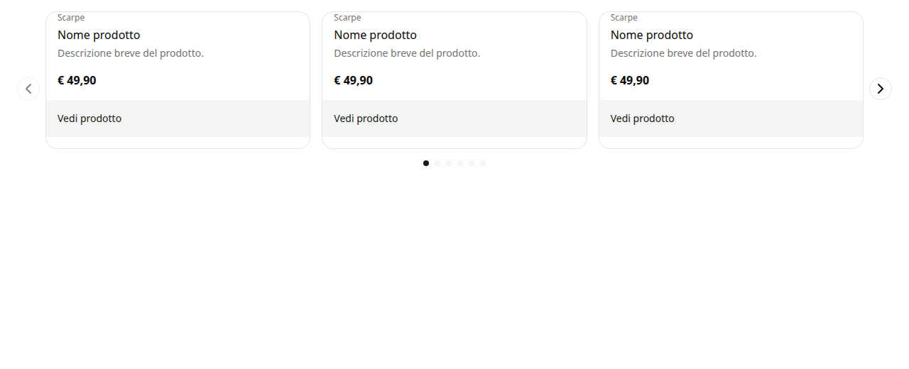
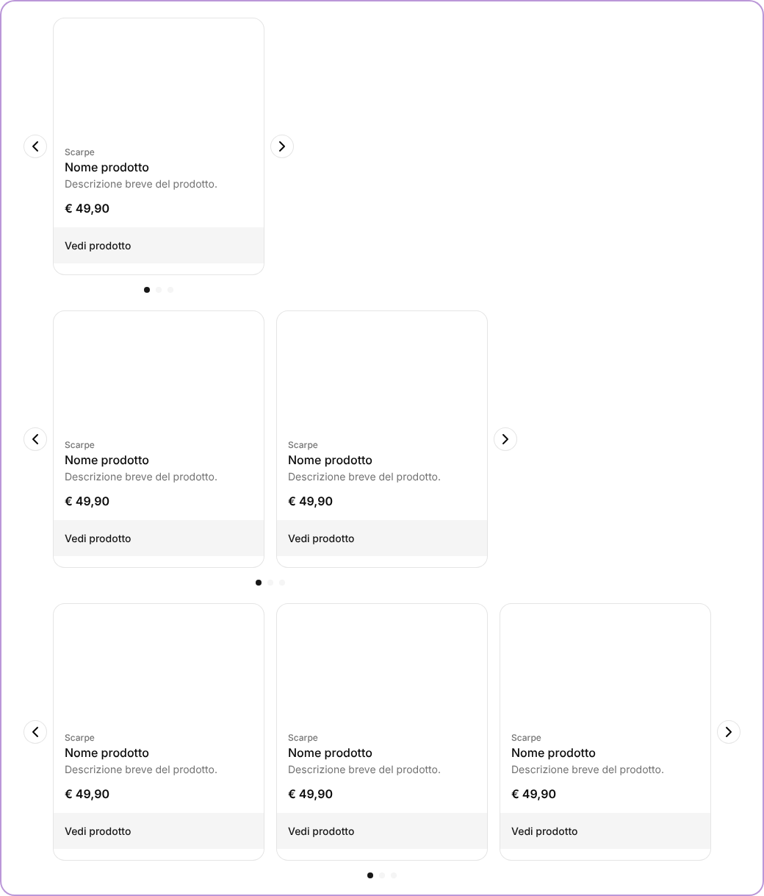
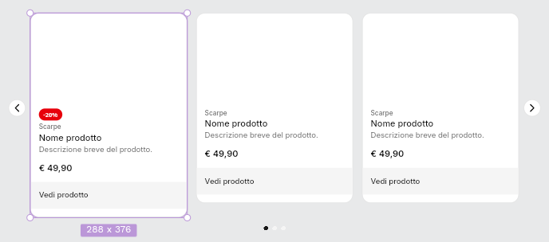
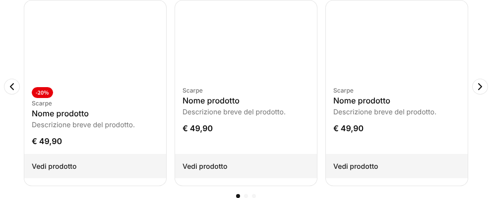
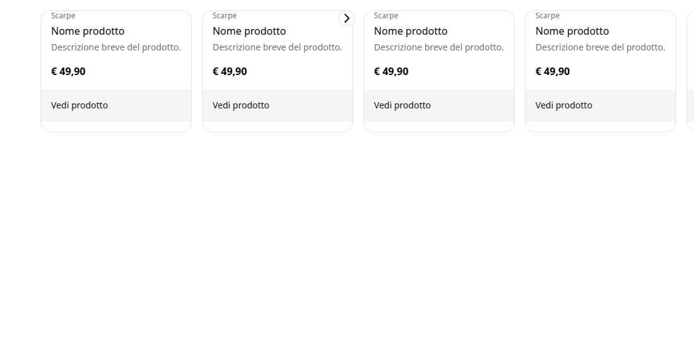
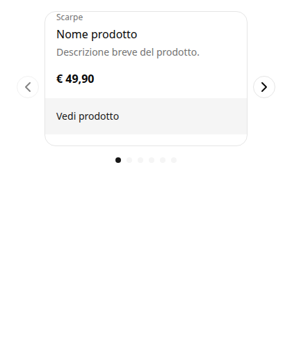
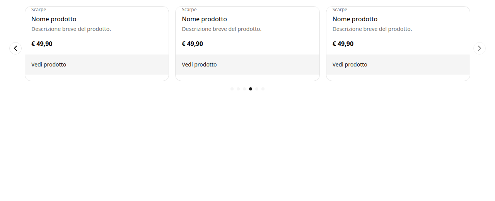

# Caso d'uso — Carousel, dal prompt al componente

Simulazione completa delle skill `pds-design` e `pds-code` su un componente **nuovo**, partendo dal contratto (spike, 2026-10-11, prova F). I prompt sono quelli dati da Alessandro; le operazioni su Penpot (via MCP) e sul codice sono reali.

**In breve:** un carousel di ShopCard, disegnato in Penpot e generato con il modello "stili generati, componente tuo". Il generatore scrive l'aspetto letto da Penpot; il componente React è dello sviluppatore, che ci aggiunge il comportamento (proposto dalla skill e approvato). Dal primo prompt al carousel funzionante: 8 passi, 4 approvazioni.



## Il percorso

| # | Prompt | Skill · comando | Cosa succede |
|---|---|---|---|
| 1 | `/pds-design` | menu | stato del file Penpot (tema, componenti esistenti) |
| 2 | `CN, vorrei un carousel` | pds-design · **CN** | la skill trova la [ricetta shadcn](../../recipes/carousel.md) e fa 7 domande, ognuna con una proposta |
| 3 | *slide = shop-card, max 3 visibili, autoplay impostabile, solo orizzontale…* | **CN** | propone i due contratti → **approvato**; li scrive, registra la sezione, `SCHEMA_VERSION` 6 → 7 |
| 4 | `DC` | pds-design · **DC** | disegna il container `Carousel` in Penpot con i token esistenti; verifica di salvataggio |
| 5 | *(il designer prova una card scontata)* | — | le card non restano allineate → correzione di design in Penpot (altezza "fill") |
| 6 | `/pds-code GC Carousel` | pds-code · **VC + GC** | `Carousel.styles.ts`, scaffold di `Carousel.tsx`, story; **giudizio negativo** in Storybook |
| 7 | `A poi B` | **AC** | A: la pipeline impara a leggere ritaglio, dimensioni e posizione; aspetto completo |
| 8 | *approvo* | **comportamento** | B: diff proposto sul `Carousel.tsx` dello sviluppatore → **approvato**; verifica del comportamento |

## 1–3. Contratto nuovo (CN)

La skill parte da una ricetta, non da zero: il Carousel di shadcn (`base`, v4) letto dal sorgente e riassunto in [`recipes/carousel.md`](../../recipes/carousel.md) — parti, asse `orientation`, comportamento con embla, cosa non si può disegnare in Penpot.

Le risposte di Alessandro decidono il modello: le slide sono **ShopCard scelte nell'editor**, quindi il carousel è una **sezione con slot** (come l'Accordion), non un componente.

**Contratto dell'editor** — [`sections/carousel.ts`](../codice/packages/contracts/src/sections/carousel.ts)
```ts
fields: {
  perView:  { schema: z.enum(["1", "2", "3"]).default("3"), kind: "structure" }, // cambia il disegno → asse delle celle Penpot
  autoplay: { schema: z.boolean().default(false), kind: "content" },             // lo imposta chi compone la pagina
  interval: { schema: z.number().int().min(2).max(15).default(5), kind: "content" },
  label:    { schema: z.string().min(1), kind: "content" },                      // nome accessibile della regione
},
slots: [{ id: "slides", allow: ["shop-card"] }],
```

**Collegamento** — [`carousel.binding.ts`](../codice/packages/scripts/src/contracts/carousel.binding.ts)
```ts
defineBinding(sectionContract(carousel, { axes: ["perView"] }), {
  domain: "layout",
  parts: {
    root:         { element: "section", attribute: { "aria-label": "label" } },
    slides:       { slot: "slides" },              // le ShopCard in Penpot sono esempi
    dots:         { repeat: "slides" },            // un pallino per slide
    previous:     { element: "button" },
    previousIcon: { icon: "lucide:ChevronLeft" },  // tracciato in Penpot → icona lucide nel codice
    // …next, nextIcon
  },
});
```
Tre concetti nuovi per la pipeline: `slot`, `repeat`, `icon`.

## 4–5. Disegno in Penpot (DC)

Container `Carousel` con plugin data `carousel@1` e tre celle (`perView` = 1, 2, 3): frecce assolute ai lati, `Viewport` › `Slides` con istanze di ShopCard, pallini (`DotActive`, `Dot`). Solo token esistenti.



**Il designer prova un caso reale**: una card con lo sconto è più alta e le card non restano allineate. La correzione è di design, in Penpot: istanze in `Slides` ad altezza "fill", `Content` della ShopCard in "fill" (il footer resta in fondo).

| Prima | Dopo |
|---|---|
|  |  |

La pipeline si adatta al designer: "fill" su un'istanza dice **come occupa il posto**, non come appare, quindi non è un override vietato (D2).

## 6. Generazione (GC) — e un giudizio negativo

`pds-code GC` verifica (0 blocchi) e scrive tre file:

| File | Di chi |
|---|---|
| [`Carousel.styles.ts`](../codice/packages/ui/src/domains/layout/Carousel.styles.ts) | `@generated`: una `cva` per parte, letta da Penpot |
| [`Carousel.tsx`](../codice/packages/ui/src/domains/layout/Carousel.tsx) | **dello sviluppatore**: scaffold scritto una volta, poi mai riscritto |
| [`Carousel.stories.tsx`](../codice/packages/ui/src/domains/layout/Carousel.stories.tsx) | `@generated`: una story per `perView`, con le ShopCard di default della sezione |

Il giudizio in Storybook è **negativo**, ed è il risultato più utile della prova: card fuori dal contenitore, frecce fuori posto, pallini invisibili.



La skill separa le due cause e le propone come A e B:
- **A — aspetto disegnato che la pipeline non legge** (limite della pipeline): ritaglio, dimensioni fisse, posizione degli elementi assoluti.
- **B — comportamento**, che non è nel disegno: scorrimento, stato, tastiera, autoplay.

## 7. A: l'aspetto viene da Penpot

Il reader impara a leggere ritaglio (`overflow-hidden`), dimensioni fisse in scala (32 px → `size-8`, 8 px → `size-2`) e la posizione degli assoluti **dai vincoli del designer** (sinistra + centro → `left-2 top-1/2 -translate-y-1/2`), più `relative` sul genitore.

```ts
previous: cva("-translate-y-1/2 absolute bg-background border-border … left-2 rounded-full size-8 top-1/2", …),
dot:      cva("bg-muted rounded-full size-2", …),
```

## 8. B: il comportamento è dello sviluppatore

La skill propone un diff sul `Carousel.tsx` (+97/−9 righe); Alessandro approva. Le classi di Penpot restano tutte (`s.*`): il comportamento aggiunge solo le sue accanto.

```tsx
<div ref={track} onScroll={onScroll} data-slot="carousel-slides"
  className={cn(s.slides(axes), "w-full snap-x snap-mandatory overflow-x-auto scroll-smooth [scrollbar-width:none]")}>
  {React.Children.map(children, (child, i) => (
    <div data-slot="carousel-slides-item" role="group" aria-roledescription="slide" aria-label={`${i + 1} di ${count}`}
      className={cn(s.slidesItem(axes), basis[perView], "snap-start")}>{child}</div>
  ))}
</div>
```

- scorrimento a scatti; slide visibili da `perView` (sul telefono sempre una)
- frecce disabilitate ai bordi, pallini cliccabili con `aria-current`, tastiera ← →
- autoplay ogni `interval` secondi, in pausa con mouse, focus o `prefers-reduced-motion`
- a11y della ricetta (`aria-roledescription`, "1 di 6")

| Desktop, inizio | Telefono | Desktop, fine (pallino 6) |
|---|---|---|
|  |  |  |

Verificato pilotando Chrome via DevTools: "successiva" → slide 2; pallino 6 → fine, "successiva" disabilitata; tasto ← → indietro di una.

## Cosa dimostra

1. **Il percorso delle skill regge su un componente nuovo e complesso**: ricetta → domande → contratti → disegno → codice, con l'umano che approva i punti di decisione.
2. **Stili generati, componente tuo** funziona anche con molto comportamento: da qui un cambio di aspetto in Penpot tocca solo `Carousel.styles.ts`, e il comportamento scritto non viene mai riscritto.
3. **La pipeline si adatta al designer**: il caso della card scontata è stato risolto in Penpot, e la pipeline ha imparato a leggerlo.
4. **Il giudizio in Storybook serve**: ha scoperto tre limiti del reader che nessun controllo automatico vedeva.

## Cosa resta aperto

- In Penpot i board ritagliano per default: `overflow-hidden` compare quasi ovunque. Da decidere quando leggerlo.
- I pallini sono uno per slide: con `perView` > 1 gli ultimi portano tutti alla fine.
- Penpot non esprime "alte come la più alta" senza fissare la striscia: il generatore ignora quella misura (regola da validare).
- Le sezioni nella pipeline (`sectionContract`, `slot`/`repeat`/`icon`) sono da progettare nella forgia.

Dettaglio dei passi: [prove.md, prova F](../../prove.md#prova-f--carousel-simulazione-completa-della-skill-2026-10-11). Lettura di Penpot usata: [`lettura-penpot.json`](lettura-penpot.json).
