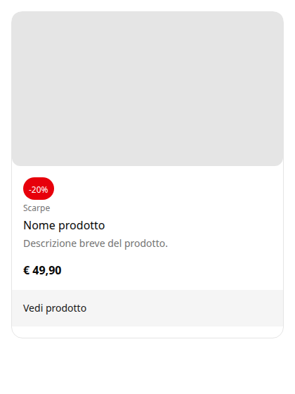

# Caso d'uso — ShopCard, il modello v3 su un componente esistente

ShopCard (card prodotto dalla ricetta shadcn Card, [`recipes/card.md`](../../recipes/card.md)), disegnata in Penpot nella prova D e usata per provare il modello v3 (prova E e seguenti, 2026-10-10/11). Dettaglio in [prove.md](../../prove.md#prova-e--test-v3-collegamento-verifica-e-generatore-generici).

## Il percorso

| Passo | Cosa si prova | Esito |
|---|---|---|
| T1 | due contratti piccoli: editor + collegamento | 12 + 9 righe; spariscono nomi di layer, ruoli, contenitori |
| T2 | verifica (VC) sulla lettura di Penpot | 0 blocchi; layout flex e istanza del Badge letti |
| T3–T4 | generatore generico | componente e 4 story senza una riga specifica per la card; dopo le correzioni (font, bordo, "fill") molto vicino a Penpot |
| T4b | modifiche a mano | gli agganci (`behavior.ts`, `aria`, eject) davano poca elasticità → **decisione 11**: il generatore scrive solo `ShopCard.styles.ts`, `ShopCard.tsx` è dello sviluppatore |
| T5 | il designer cambia il raggio (`radius.xl` → `radius.2xl`) | **una riga** di `ShopCard.styles.ts`; il file modificato a mano resta identico |
| T6 | il designer aggiunge una categoria | VC blocca; MS propone `category` nei contratti (approvato, `SCHEMA_VERSION` 6); AC rigenera gli stili e propone il diff del componente (approvato) |

## Codice

| File | Di chi |
|---|---|
| [contratto dell'editor](../codice/packages/contracts/src/components/shop-card.ts) | approvato (CN, MS) |
| [collegamento](../codice/packages/scripts/src/contracts/shop-card.binding.ts) | approvato (CN, MS) |
| [`ShopCard.styles.ts`](../codice/packages/ui/src/domains/commerce/ShopCard.styles.ts) | `@generated` da Penpot |
| [`ShopCard.tsx`](../codice/packages/ui/src/domains/commerce/ShopCard.tsx) | **dello sviluppatore**: scaffold + immagine lazy con segnaposto, `aria-hidden` sulla CTA, categoria (T6) |
| [`ShopCard.stories.tsx`](../codice/packages/ui/src/domains/commerce/ShopCard.stories.tsx) | `@generated` |

## Materiale

| File | Cosa |
|---|---|
| `lettura-penpot.json` | lettura di Penpot usata per T2–T4 |
| `lettura-penpot-t6.json` | lettura dopo T5 (raggio) e T6 (categoria) |
| `storybook/sc3-*.png` | le 4 story dopo le correzioni (T4) |
| `storybook/t6-*.png` | con la categoria (T6) |

La lettura più recente della ShopCard (con `Content` in "fill", prova F) è dentro [`../carousel/lettura-penpot.json`](../carousel/lettura-penpot.json).
